# Phase 1 architecture

The website is the user interface. Windows users open it in a current Chrome/Edge browser and choose a PDF. No desktop shell, model, Python environment, cloud database, or second PDF engine is shipped.

```mermaid
flowchart LR
  File[Local PDF bytes] --> PDF[PDF.js worker + canvas + text layer]
  PDF --> Extract[Geometry + sentence segments]
  Extract --> Source[Stable page IDs + character ranges]
  Source --> Align[Explicit bilingual link graph]
  Align --> UI[PDF ↔ Chinese selection]
  UI --> Notes[Annotations + source references]
  Notes --> Store[IndexedDB or session memory]
  Store --> Export[Markdown / versioned JSON]
  Source -. consent .-> Adapter[Optional HTTPS translator]
  Adapter --> Validate[Validate IDs; mark unreviewed]
  Validate --> Align
```

## Module boundaries

- `pdf.js` is the only module importing PDF.js. It owns document loading, password prompts, render/text-layer cancellation and exact browser character-range rectangles. It never saves a PDF.
- `extraction.js` is independent of the DOM. PDF text items become geometric rows, conservative column bands, blocks and sentence ranges. Every source carries original item indices and character offsets. Full-width regions divide two-column bands. No language model is used. Formulas, tables, missing punctuation, page boundaries and suspect character encodings are flagged.
- `alignment.js` handles explicit edges from Chinese records to one or more source IDs. Empty edges remain unaligned. Cross-page IDs must already exist. PDF hit-testing requires an actual containing rectangle; it never picks a nearby guessed sentence.
- `translation.js` handles bounded, cancellable HTTPS JSON requests only after consent. It sends only sentence text and IDs, never PDFs, notes, cookies or provider secrets. Corrupt character mappings block requests. All returned links start unreviewed.
- `annotations.js` defines portable notes and backup validation. A backup is tied to the SHA-256 of the source PDF. Before import, `app.js` re-extracts the actual PDF and checks each source. Existing work is retained; imported copies append and translations need review.
- `storage.js` commits IndexedDB writes transactionally. `app.js` serializes writes, keeps a current session copy and provides export on save failure. Session mode avoids new disk writes; it does not silently delete prior data.
- `core.js` contains shared validation and Markdown escaping. `app.js` coordinates these modules and owns DOM updates using `textContent`.

## Identity and trustworthy references

A document ID is its full SHA-256, independent of filename/path. A source ID names a page and extraction segment, and retains character offsets into that page's text content. Normalized rectangles survive zoom. Actual rendered text ranges refine geometry, so a source crossing lines or columns gets multiple separate boxes instead of one giant bounding rectangle.

Upgrades do not silently assign old note IDs to newly segmented text. If extraction changes, saved IDs and text are preserved. Only a unique exact whitespace-normalized quote gets recovered geometry; absent or repeated quotes remain unresolved with an explicit warning. Backups with unverifiable quotes are rejected atomically.

The link graph is evidence of a supplied correspondence, not proof of translation accuracy. Human-entered links are labeled user-confirmed; imported/service links stay unreviewed until explicitly confirmed. A sentence broken across pages is not automatically joined. The user may visit both pages and edit the list of source IDs.

## Persistence and ownership

The app stores sidecar notes, extracted text, links and progress only. Source PDFs are neither rewritten nor retained by the app. No file-system write permission is requested. Markdown provides readable references and JSON preserves structured state. JSON restoration currently appends; it is not an automatic deduplicating sync engine. A browser profile/origin is the storage boundary; multiple tabs are not a collaborative editor.

## Deployment boundaries

The build verifies one pinned PDF.js archive and emits about 6.4 MB of static assets, excluding sourcemaps, development tools and test PDFs. Fonts/CMaps/WASM load only as PDF.js needs them. GitHub Actions tests both the app and temporary real-paper fixtures; Pages receives only `dist/`. A post-deployment job exercises the actual Pages URL with an isolated browser profile. No live translation provider or paid resource is provisioned.
